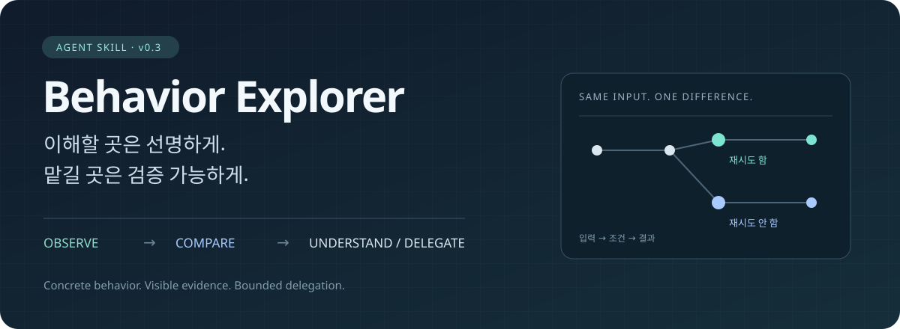

<p align="center">
  
</p>

<p align="center">
  <strong>필요한 동작만 이해하고, 나머지는 검증 기준과 함께 맡기세요.</strong><br>
  AI 에이전트와 일하는 개발자를 위한 동작 탐색 스킬 · Claude Code · Codex
</p>

<p align="center">
  <a href="#설치">설치</a> ·
  <a href="#사용">사용</a> ·
  <a href="#예시-재시도-비교">예시</a> ·
  <a href="#근거-표시">근거 표시</a> ·
  <a href="#한계">한계</a>
</p>

---

에이전트가 "재시도 구현 완료, 테스트 통과"라고 보고해도, 내가 기대한 동작이 나오는지는 알기 어렵습니다.
Behavior Explorer는 결과를 바꾸는 **경계 하나**를 골라 구체적인 입력과 결과로 보여 주고, 나머지는 검증 기준과 함께 맡기게 합니다.


## 설치

저장소 루트가 스킬 하나입니다. 폴더 이름은 `behavior-explorer`로 맞추세요.

**Claude Code**

```sh
git clone https://github.com/seok-jun/decision-explorer.git ~/.claude/skills/behavior-explorer
```

**Codex**

```sh
git clone https://github.com/seok-jun/decision-explorer.git ~/.codex/skills/behavior-explorer
```

`CODEX_HOME`을 따로 쓰면 그 아래 `skills/behavior-explorer`에 두세요. 별도 런타임이나 의존성은 없습니다.

## 사용

Claude Code에서는 `/behavior-explorer`, Codex에서는 `$behavior-explorer`로 부릅니다.

```text
/behavior-explorer 병합 전에 어디를 봐야 할지 모르겠어. 결과를 바꿀 수 있는 경계 하나부터 보여줘.
```

| 알고 싶은 것 | 요청 예시 |
| --- | --- |
| 왜 이렇게 됐을까? | 이번 요청이 재시도된 이유를 실제 입력과 결정 함수 결과로 설명해줘. |
| 왜 안 일어났을까? | 자동 복구될 줄 알았는데 멈췄어. 복구를 막은 조건을 보여줘. |
| 조건 하나를 바꾸면? | 캐시를 끄면 이번 요청의 값과 경로가 어떻게 달라져? |
| 무엇을 맡기면 될까? | 중복 처리 조건까지만 이해할게. 나머지는 검증 기준을 정해서 맡길게. |

"코드부터 보여줘", "이제 이해했으니 진행해"처럼 자유롭게 이어 가면 됩니다. 퀴즈나 재설명은 요구하지 않습니다.

**언제 끼어드나요?** 동작을 이해해 달라는 요청, 그리고 질문·완료 보고·병합 직전에 결과를 바꾸는 경계가 있을 때뿐입니다.
일반 디버깅, 단순 수정, 이미 승인한 작업에는 아무것도 덧붙이지 않습니다. 새 승인 절차도 만들지 않습니다.

## 예시: 재시도 비교

> "재시도는 넣었다는데, 어떤 실패에서 실제로 다시 시도하는 거야?"

재시도 한도는 둘 다 3회이고, `retryable`만 바꾼 두 실행입니다.

| | 재시도 함 | 재시도 안 함 |
| --- | --- | --- |
| 바꾼 입력 | `retryable=true` | `retryable=false` |
| 시도 0의 결정 | `decisionRetry=true` | `decisionRetry=false` |
| 이후 기록 | 시도 1·2·3 | 없음 |

**[비교 HTML](assets/replay-example.html)** · **[원시 기록](assets/replay-example-trace.json)**

클론한 뒤 HTML을 브라우저에서 여세요. **첫 차이**로 이동하고, 같은 위치에서 실행을 바꿔 가며 달라지는 값과 없는 기록을 확인할 수 있습니다.

이 페이지는 캡처한 기록을 읽는 화면이며 시뮬레이터가 아닙니다. 확인한 것은 결정 함수의 출력뿐입니다. 시도 순서는 테스트 하네스가 만들었고, 실제 워커 재실행·네트워크 실패·대기 시간은 확인하지 않았습니다.

## 근거 표시

스킬은 모든 주장에 근거 종류를 붙입니다.

| 표시 | 의미 |
| --- | --- |
| **실행 확인** | 명시한 입력과 환경에서 실제로 기록한 값 |
| **코드 추정** | 코드에서 추론했지만 실행하지 않은 경로나 인과 |
| **가상 예시** | 가능성을 설명하려고 만든 사례 |
| **미확인** | 현재 근거로 판단할 수 없음 |

핵심 주장은 코드나 원시 기록의 위치와 연결하고, 기존 테스트·로그·계약 중 하나와 실제로 대조합니다.
테스트 통과를 실행 기록으로 취급하지 않으며, 기록이 없다고 실행되지 않았다고 단정하지 않습니다.

## 구성

```text
SKILL.md              스킬 지침
agents/openai.yaml    Codex 표시 정보
assets/               비교 HTML과 원시 기록
references/           HTML 작성법 · 평가 방법 · 설계 출처
evals/evals.json      수동 평가 사례 10개
```

## 한계

**v0.3.0은 초안입니다.**

- [평가 사례](evals/evals.json) 10개는 기대 동작을 적은 것이며, 실행기가 없고 통과 결과도 아닙니다.
- 효과 근거는 저자 1명이 사례 1개로 해 본 보고가 전부입니다. 이해가 향상된다거나 HTML이 표보다 낫다는 것은 입증되지 않았습니다.
- 예시의 코드 경로는 축약되어 있어 이 저장소만으로는 캡처를 재현할 수 없습니다.

평가 방법과 HTML 방식을 버릴 기준은 [evaluation.md](references/evaluation.md), 설계 출처는 [sources.md](references/sources.md)에 있습니다.

## v0.2에서 달라진 점

이름이 Decision Explorer에서 Behavior Explorer로 바뀌었습니다. 저장소 주소는 그대로입니다.

| | v0.2 | v0.3 |
| --- | --- | --- |
| 목표 | 선택의 결과를 이해하고 결정 | 필요한 동작을 이해하거나 검증과 함께 위임 |
| 표현 | 선택·조건별 결과 비교 | 짧은 대화, 필요할 때 두 실행 비교 HTML |
| 내부 장치 | 결정 계약·상태 저장·검증기 | 모두 제거 |

v0.2의 계약 검사 53개는 v0.3의 검증 결과가 아닙니다. 이전 버전은 [`v0.2.0` 태그](https://github.com/seok-jun/decision-explorer/tree/v0.2.0)에 있으며, 기존 `decision-explorer` 설치는 자동으로 바뀌지 않습니다.

## 라이선스

[MIT](LICENSE)
