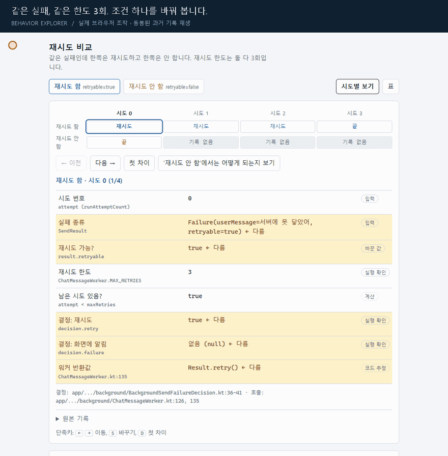

<h1 align="center">Behavior Explorer</h1>

<p align="center">
  <strong>필요한 동작을 이해하고, 나머지는 검증 기준과 함께 위임하세요.</strong><br>
  AI 에이전트와 일하는 개발자를 위한 선택적 동작 탐색 스킬
</p>



**같은 위치에서 두 실행을 오가며, 달라지는 값과 없는 기록을 확인하세요.**
위 GIF는 동봉된 HTML의 실제 브라우저 조작을 녹화했습니다. 화면 위 설명과 클릭 위치 표시를 덧붙였으며, 앱의 워커나 네트워크를 새로 실행한 영상은 아닙니다.

<p align="center">
  <a href="#바로-사용하기">바로 사용하기</a> ·
  <a href="#한-장면으로-이해하기">동작 예시</a> ·
  <a href="#설치">설치</a> ·
  <a href="SKILL.md">스킬 지침</a> ·
  <a href="#검증-상태와-한계">검증과 한계</a>
</p>

> **v0.3.0 초안 · Decision Explorer → Behavior Explorer**
>
> 저장소 주소는 `decision-explorer`를 유지합니다. 현재 스킬 이름과 호출 명령은 **`behavior-explorer` / `$behavior-explorer`**입니다. 이전 v0.2.0은 Git 이력과 기존 태그에서 확인할 수 있습니다.

## 코드가 바뀌었다. 그래서 무엇이 달라졌을까?

“테스트 통과”, “재시도 구현 완료”만으로는 내가 기대한 동작이 나오는지 알기 어렵습니다.
Behavior Explorer는 지금 작업에서 중요한 경계를 찾아, 구체적인 입력과 결과로 설명합니다.

- **어디부터 볼지 모를 때** — 기대 결과·검증 범위·위임 판단을 바꾸는 경계부터 짚습니다.
- **왜 이런 결과인지 궁금할 때** — 실제 코드와 기록을 따라 원인, 막힌 조건, 바뀌는 값을 보여줍니다.
- **충분히 이해했을 때** — 남은 범위와 검증 기준을 정하고 작업을 이어갑니다.

짧은 질문은 대화로 답합니다. 같은 값과 사건을 여러 번 비교해야 할 때는 **위치를 유지하며 두 실행을 오가는 HTML**을 사용합니다. 화면을 만드는 것 자체가 목적은 아닙니다.

## 바로 사용하기

설치 후 에이전트에게 다음처럼 요청하세요.

```text
$behavior-explorer 이번 변경에서 내가 이해해야 할 중요한 동작 경계
하나부터 보여줘. 확인한 사실과 추론을 나누고, 나머지는 어떤 검증에
맡길 수 있는지 알려줘.
```

| 알고 싶은 것 | 복사해서 쓸 요청 |
| --- | --- |
| 어디부터 봐야 할까? | `$behavior-explorer 병합 전에 어디를 봐야 할지 모르겠어. 결과를 바꿀 수 있는 경계 하나부터 보여줘.` |
| 왜 이렇게 됐을까? | `$behavior-explorer 이번 요청이 재시도된 이유를 실제 입력과 결정 함수 결과로 설명해줘.` |
| 왜 기대한 일이 안 일어났을까? | `$behavior-explorer 자동 복구될 줄 알았는데 멈췄어. 복구를 막은 조건과 근거를 보여줘.` |
| 조건 하나를 바꾸면? | `$behavior-explorer 캐시를 끄면 이번 요청의 값과 경로가 어떻게 달라져? 실행하지 못한 부분은 추론으로 표시해줘.` |
| 무엇을 맡기면 될까? | `$behavior-explorer 중복 처리 조건까지만 이해하고 싶어. 나머지는 검증 범위와 완료 기준을 정해서 맡길게.` |

질문 순서는 자유롭습니다. “코드부터 보여줘”, “이 조건만 더 보자”, “이제 이해했으니 진행해”처럼 대화를 이어가면 됩니다. 예측 문제나 재설명은 필수가 아닙니다.

## 한 장면으로 이해하기

**“재시도는 넣었다는데, 어떤 실패에서 실제로 다시 시도하는 거야?”**

동봉된 과거 실험 기록은 같은 재시도 한도에서 `retryable` 조건을 바꾼 두 실행을 비교합니다.
**재시도 한도는 둘 다 3회입니다.**

| 비교 지점 | 재시도 함 | 재시도 안 함 |
| --- | --- | --- |
| 바꾼 입력 | `retryable=true` | `retryable=false` |
| 시도 번호 0의 결정 함수 출력 | `decisionRetry=true` | `decisionRetry=false` |
| 후속 기록 | 테스트 하네스가 시도 번호 1·2·3을 공급 | 후속 시도 기록 없음 |
| 시도 번호 3 | 재시도하지 않는 결정 | 대응 기록 없음 |

여기서 직접 확인한 것은 **결정 함수 출력**입니다. 실제 네트워크 실패, 워커 재실행, 재시도 대기 시간은 이 기록으로 확인하지 않았습니다. 하네스가 만든 호출 순서를 실제 앱 실행으로 해석하면 안 됩니다.

**[두 실행 비교 HTML](assets/replay-example.html)** · **[원시 기록 JSON](assets/replay-example-trace.json)**

저장소를 클론한 뒤 HTML을 브라우저에서 열어 보세요. GitHub 파일 화면은 HTML을 실행하지 않습니다.

1. **첫 차이**로 이동해 달라진 입력과 결정을 봅니다.
2. **다음**으로 이동한 뒤 **재시도 안 함**으로 바꿔 봅니다. 같은 시도 위치에서 대응 기록의 유무를 비교할 수 있습니다.
3. **표**로 전체 기록을 보고, **원본 기록**과 **확인 범위**로 설명의 근거와 한계를 확인합니다.

이 예시는 캡처된 기록을 읽는 페이지입니다. 임의 조건으로 앱을 실행하는 시뮬레이터가 아닙니다. 과거 캡처를 이번 갱신에서 다시 실행한 것은 아니며, 원래 코드 경로와 명령도 일부 축약되어 있습니다.

## 완료 보고에도 필요한 경계가 있습니다

예를 들어 요구사항이 “자동 복구”인데 특정 실패는 수동 재처리가 필요하다면:

> 일반 실패는 자동으로 복구하지만, 이 실패는 사람이 다시 처리해야 합니다.
> 따라서 합의한 자동 복구 범위를 아직 충족하지 못했습니다.
> 원하면 **수동 재처리가 필요한 조건**부터 살펴볼 수 있습니다.

이는 **가상 보고 예시**입니다. 중요한 차이는 선택적 상세 설명 뒤에 숨기지 않습니다. 요구사항 미충족과 아직 실행하지 않은 검증을 나누며, 남은 테스트를 통과했다는 이유만으로 동작 차이가 해결됐다고 보고하지 않습니다.

## 언제 작동하나요?

| 상황 | 스킬의 역할 |
| --- | --- |
| 특정 작업의 동작을 이해해 달라는 요청 | 질문에 필요한 입력·조건·결과·근거를 탐색 |
| 사용자에게 판단을 묻기 직전 | 조사 가능한 사실을 먼저 확인하고, 선택의 영향을 설명 |
| 완료 보고 또는 승인·병합 인계 | 기대 결과나 위임 판단을 바꾸는 중요한 경계가 있으면 짧게 공개 |
| 일반 디버깅·일반 교육·단순 수정 | 별도 탐색 절차를 추가하지 않음 |
| 이미 이해하고 승인한 작업을 설명 없이 적용하라는 요청 | 기존 권한과 범위에 따라 진행 |

모든 인계에 설명을 붙이지 않습니다. 탐색이 필요한 경계가 없다면 그대로 작업을 마칩니다.
미리보기 조작은 실행이나 병합 지시가 아니며, 스킬이 새 승인 절차를 만들지도 않습니다.

## 설명을 믿을 수 있게

| 근거 | 의미 |
| --- | --- |
| **실행 확인** | 명시된 입력·경로·환경에서 기록한 값이나 출력 |
| **코드 추정** | 자료에서 추론했지만 실행으로 확인하지 않은 경로나 인과관계 |
| **가상 예시** | 가능성을 설명하기 위해 만든 사례 |
| **미확인** | 현재 근거로 판단할 수 없는 결과 |

핵심 주장은 정확한 코드·원시 기록 위치와 연결하고, 기존 테스트·로그·명시적 계약 중 하나와 실제로 대조합니다. 중요한 추론에는 어떤 관측이 나오면 설명이 틀린지도 밝힙니다. 테스트 PASS는 실행 trace가 아니며, 기록이 없다는 사실만으로 실행되지 않았다고 단정하지 않습니다.

## 설치

이 저장소 루트가 하나의 스킬입니다. **설치 폴더 이름은 `behavior-explorer`**로 맞추세요.
기존 설치가 있다면 로컬 변경을 확인한 뒤 갱신합니다.

**Codex · Windows PowerShell**

```powershell
git clone https://github.com/seok-jun/decision-explorer.git "$HOME/.codex/skills/behavior-explorer"
```

**Codex · macOS / Linux**

```sh
git clone https://github.com/seok-jun/decision-explorer.git "${CODEX_HOME:-$HOME/.codex}/skills/behavior-explorer"
```

Windows에서도 `CODEX_HOME`을 별도로 설정했다면 해당 경로의 `skills/behavior-explorer`를 사용하세요.
다른 에이전트에서는 그 호스트가 지원하는 스킬 디렉터리에 같은 이름으로 설치합니다.

`C:\decision-explorer`처럼 개발용 위치에 클론했다면 아래 파일과 디렉터리를 개인 스킬 폴더에 복사하세요. 개발용 클론만으로는 개인 스킬 설치가 되지 않습니다.

```text
behavior-explorer/
├── SKILL.md
├── agents/openai.yaml
├── assets/                 두 실행 비교 HTML과 원시 기록
├── references/             표현 방식·평가·설계 출처
└── evals/evals.json        수동 평가용 10개 사례
```

호스트에서 스킬이 검색되는지 확인한 뒤 `$behavior-explorer`로 시작하세요.
스킬 자체에 별도 Python 검증기, 실행 서버, 렌더러 설치는 필요하지 않습니다. HTML 예시의 조작에는 JavaScript를 지원하는 브라우저가 필요하며, HTML을 사용할 수 없는 환경에서는 대화나 표로 설명합니다.

이전 `decision-explorer` 설치는 자동으로 이름이 바뀌지 않습니다. 새 스킬로 전환한 뒤에는 이전 설치를 함께 활성화할 필요가 있는지 확인하세요. 재현 가능한 채택에는 실제로 사용한 커밋을 고정하고, 프로젝트 고유 권한·운영 규칙은 프로젝트에 유지합니다.

## v0.2에서 바뀐 점

| 항목 | Decision Explorer v0.2 | Behavior Explorer v0.3 초안 |
| --- | --- | --- |
| 목표 | 선택의 결과를 이해하고 결정 | 필요한 동작을 이해하거나 범위·검증을 위임 |
| 시작점 | 미결 선택 | 구체적인 이해 요청과 중요한 인계 경계 |
| 표현 | 선택·조건별 결과 비교 | 짧은 대화, 필요할 때 정렬된 두 실행 탐색 |
| 내부 장치 | 결정 계약·상태 저장·검증기 | 해당 장치 제거 |
| 완료 기준 | 결정과 적용 상태 | 필요한 이해 또는 명시적인 검증 위임 |

이번 갱신은 W의 `a6756e2b80324e31acd798c6770d143d01c9414a`에 반영된 스킬 8개 파일을 기준으로 합니다. W의 완료 인계 보완을 포함하며, 원본 lock의 SHA-256과 대조해 가져왔습니다. 프로젝트 연결 문서와 제품별 권한은 스킬에 포함하지 않습니다.

## 검증 상태와 한계

**v0.3.0은 초안입니다.** [수동 평가 사례](evals/evals.json) 10개와 [경량 평가 방법](references/evaluation.md)이 있으며, 사례 정의는 모델 행동 평가의 통과를 의미하지 않습니다.

과거 재시도 사례의 저자 보고는 **1인·1사례**입니다. 이해 향상이나 HTML의 일반적인 우월성이 입증된 것은 아닙니다. 캡처·환경 설정·화면 생성·후속 질문의 비용까지 평가하도록 설계했습니다.

v0.2의 계약 검사 53개와 이전 UI 회귀 결과는 v0.3의 검증 결과로 승계하지 않습니다. 해당 검증기·상태 계약·fixture·runner는 이번 전환에서 제거했습니다. 현재 동작 지침, 실제 UI 확인, 사용자 이해·위임 정확도는 서로 다른 검증 범위입니다.

더 살펴보기: [스킬 전체 지침](SKILL.md) · [HTML 탐색 지침](references/replay-html.md) · [평가 방법](references/evaluation.md) · [설계 출처와 한계](references/sources.md)
